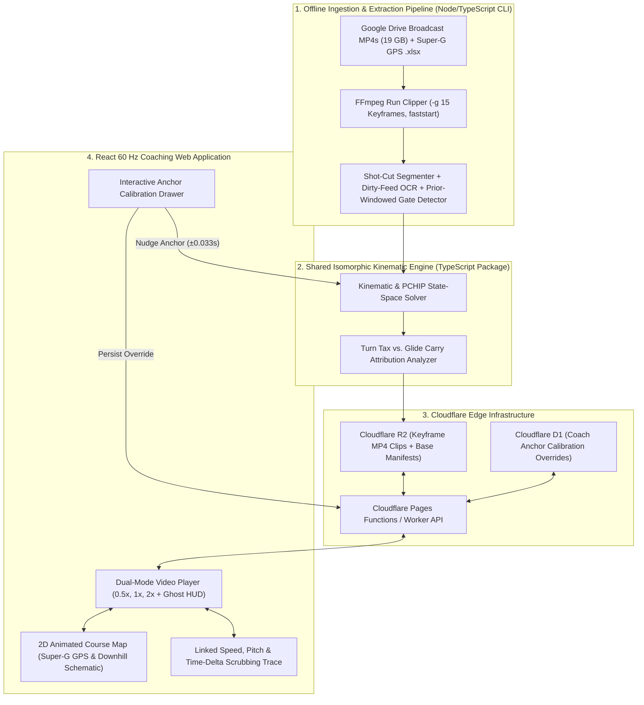

# Alpine Race Telemetry Coaching Tool

*   **Author:** [yuansshi](https://github.com/yuansshi)
*   **Status:** Approved
*   **Date:** 2026-11-10

--------------------------------------------------------------------------------

## Overview

The Alpine Race Telemetry Coaching Tool is a web application deployed on Cloudflare for the Cloudflare x U.S. Ski & Snowboard Challenge. It turns raw broadcast race footage from two provided Beaver Creek World Cup speed events, the December 5, 2025 Men's Super-G (`MEN SGWRLD CLN F 05-DEC-2025 10h42m59s29.mp4`, where `CLN F` denotes a clean broadcast feed without burned-in television graphics) and the December 4, 2025 Men's Downhill (`MEN DHWRLD DTY F 04-DEC-2025 10h27m59s29.mp4`, where `DTY F` denotes a dirty broadcast feed with burned-in timing graphics), into an interactive visual analysis environment for coaches and athletes.

In Alpine ski racing, athletes ski the course one at a time, and official International Ski and Snowboard Federation (`FIS`) timing systems report only start, finish, and three to five intermediate split times separated by 15 to 25 seconds of skiing. Coaches reviewing broadcast video cannot see continuous speed differences or pinpoint which specific turn or terrain transition caused an athlete to gain or lose time. This tool aligns full start-to-finish runs for two athletes in each discipline and presents an F1-style live ghost time-delta overlay, a synchronized 2D animated course map with two moving skier markers, variable-speed playback (`0.5x`, `1x`, `2x`), and a continuous speed and time-delta timeline with explicit data provenance and uncertainty ranges.

## The Problem

Coaches and athletes trying to extract tactical and technical insights from Alpine broadcast footage face four obstacles:

1.  **Sparse intermediate splits hide where time is won or lost.** A racer may lose `0.35s` between Split 2 and Split 3, a section spanning 10 to 12 gates and 20 seconds of skiing. Without gate-by-gate or sub-second alignment, coaches cannot separate time lost inside a steep, high-angle turn (turn execution tax) from time lost across the following flat section due to lower exit speed (glide carry loss).
2.  **Moving broadcast cameras distort visual speed perception.** Broadcast feeds cut across 8 to 12 pan-tilt-zoom cameras positioned down the mountain. Foreshortening, focal-length zoom changes, and camera panning make it difficult for the human eye or naive pixel-tracking algorithms to judge whether Skier A is traveling faster than Skier B at the same point on the hill, and manual director camera switches vary by `±0.2s to 0.6s` between runs.
3.  **Asymmetric data availability across disciplines.** Some races provide GPS gate survey sheets alongside clean broadcast feeds without on-screen timing graphics (such as the Beaver Creek Super-G asset paired with `2025-12-05_Beaver-Creek_WC_Men_SG_1Run.xlsx`), while other races provide only a dirty broadcast feed with burned-in split graphics and no course map (such as the Beaver Creek Downhill asset). A coaching tool that requires GPS survey data fails on Downhill, while a tool that requires burned-in TV split graphics fails on clean feeds.
4.  **Unquantified uncertainty in video-derived estimates.** Video-based speed and timing estimates are approximations rather than hardware photocell measurements. When tools present single numbers without confidence ranges or source labels, coaches cannot tell whether a reported `2 km/h` difference came from an official speed trap, a GPS-measured gate interval, or an interpolation across a camera cut.

The proposed solution addresses these obstacles by combining offline vision/OCR and gate-landmark extraction with a physics-constrained kinematic alignment engine that outputs a unified, dual-indexed telemetry manifest. Every metric displayed on the video HUD, the 2D course map, and the bottom scrubbing chart carries a provenance label (`OCR Measured`, `Gate-Calibrated`, `Kinematic Interpolated`, or `Manually Annotated`) and a numeric uncertainty band (`± km/h` or `± s`), while an in-app calibration drawer lets coaches inspect and adjust individual frame anchors in real time.

## Goals

*   **Full-run dual-athlete comparison across both disciplines:** Support full start-to-finish analysis comparing two athletes in the Beaver Creek Men's Super-G (`SGWRLD CLN F`, Clean Feed) and two athletes in the Beaver Creek Men's Downhill (`DHWRLD DTY F`, Dirty Feed).
*   **Course-map-independent baseline with optional Super-G GPS enhancement:** Operate from video landmarks and timing inputs alone for the baseline Downhill and Super-G workflow, while supporting the 38-row Beaver Creek Super-G GPS spreadsheet (`1,672.91m` distance, `528.80m` vertical drop) as an optional toggleable layer that adds gate numbers, section pitch, and distance-calibrated ground speeds.
*   **F1-style synchronized playback and visualization at 60 Hz:** Render a primary video player (`0.5x`, `1x`, `2x` playback speeds plus synchronized side-by-side comparison mode) with a top micro-sector gain/loss bar, a lower-left Ghost Delta and Speed HUD, a 2D animated course map showing both skiers moving simultaneously, and a linked bottom speed and time-delta chart.
*   **Explicit data provenance and live anchor calibration:** Label every displayed value with its data provenance (`OCR Measured`, `Gate-Calibrated`, `Kinematic Interpolated`, or `Manually Annotated`) and uncertainty interval, and provide an interactive anchor scrubber where adjusting a gate or landmark timestamp by single frames (`1 / nativeFps`, `~0.033s` at `29.97 fps`) recomputes all telemetry curves in under `10ms` in the browser.
*   **Actionable coaching attribution:** Generate section-by-section coaching summaries that distinguish speed changes inside turns from speed carried onto flats and link each finding directly to the corresponding video timestamp.
*   **Cloudflare deployment:** Host the web application, clipped race videos, telemetry manifests, and user calibration overrides on Cloudflare (Cloudflare Pages/Workers, R2, and D1).

## Non-Goals

*   **Official FIS timing or race adjudication:** This system is a coaching and training analysis prototype and does not replace certified International Ski and Snowboard Federation (`FIS`) photocell hardware or official competition results.
*   **Real-time browser computer-vision inference on uncut 19 GB broadcast streams:** Multi-hour raw broadcast archives are clipped to individual athlete runs and processed offline into structured JSON manifests prior to playback.
*   **3D monocular SLAM reconstruction:** The system does not attempt full 3D Simultaneous Localization and Mapping (`SLAM`) camera pose estimation from uncalibrated zoom lenses.
*   **Snowboard Rotation Analysis:** The separate Snowboard aerial rotation challenge track is out of scope.

## Open Questions

*   None at the Overview and Goals level. Architectural choices for the kinematic solver and dual-video synchronization are finalized in the Technical Plan section below.

## Critical User Journeys (CUJs)

### CUJ 1: Reviewing a Full Run with F1 Ghost Delta and 2D Animated Track Map

*   **Given**: A coach opens the Cloudflare-deployed web app and selects either the Beaver Creek Men's Super-G comparison (`Athlete A` vs. `Athlete B`) or the Beaver Creek Men's Downhill comparison.
*   **When**: The coach plays the run at `1x`, `0.5x`, or `2x` speed, or scrubs along the bottom speed and time-delta timeline.
*   **Then**: The video displays a live HUD showing elapsed run time, estimated speed (`km/h` and `mph`) with its uncertainty band (`± km/h`) and provenance badge, a green or red Ghost Time Delta badge (`-0.28s AHEAD` or `+0.19s BEHIND`) evaluated at the athlete's current course position, and a top micro-sector bar highlighting sections gained in green and lost in red; simultaneously, two athlete markers update at 60 fps along the 2D course map showing their real-time spatial separation.

### CUJ 2: Inspecting Section Coaching Insights and Side-by-Side Gate Snapshots

*   **Given**: A coach is viewing a completed run comparison and wants to know why Athlete B lost `0.35s` in the middle section of the course.
*   **When**: The coach clicks the red micro-sector or selects a coaching summary card (for example, "Lost 0.22s entering Delayed Gate 19 and carried 3.1 km/h less exit speed onto the following flat"), or switches to side-by-side **Spatial-Ghost Sync** mode.
*   **Then**: The video player seeks directly to that section, aligns both athletes at the gate or landmark passage so they enter the turn simultaneously on screen, displays a side-by-side gate passage freeze-frame comparing their line offset and body posture, and shows whether the time loss occurred during the turn or on the subsequent glide section.

### CUJ 3: Toggling the Optional Super-G Course Map Enhancement

*   **Given**: A coach or judge is viewing the Beaver Creek Men's Super-G run.
*   **When**: The user toggles the "Super-G GPS Course Map Enhancement" switch between Off (Video-Only Baseline) and On (GPS Gate-Calibrated).
*   **Then**: The browser invokes the isomorphic `solveRaceComparisonManifest()` solver locally in under `2ms`: in Off mode, the app computes progress and speed using only video landmarks, start/finish timing, and the nominal course reference length (matching the Downhill workflow); in On mode, the app overlays exact gate numbers (`Gate 1` through `Gate 37`), gate types (`Open`, standard rhythm turning gates set across the fall line, vs. `Delayed`, combination gates with an offset/double-pole rhythm change requiring a sharper line transition), section pitch percentages (`7%` to `53%`), and GPS-distance-calibrated speeds derived from `2025-12-05_Beaver-Creek_WC_Men_SG_1Run.xlsx`.

### CUJ 4: Auditing and Nudging a Gate or Landmark Timestamp Anchor

*   **Given**: A coach notices that snow spray partially obscured Gate 12 during a camera cut and wants to verify or refine the frame where the skier passed the gate.
*   **When**: The coach opens the "Inspect & Calibrate Anchors" drawer, selects Gate 12 (badged `Kinematic Interpolated`), steps the video forward by 2 frames (`+0.067s`), and clicks "Apply Anchor Override".
*   **Then**: The anchor badge updates to `Manually Annotated`, the browser-side kinematic solver recomputes the speed curve, ghost time-delta trace, and micro-sector colors in under `10ms` without page reload, and the override is saved to Cloudflare D1.

## Technical Plan (Architecture)

### 1. System Architecture Overview

The system is partitioned into four decoupled components that separate offline broadcast video processing from low-latency browser playback and interactive calibration:



1.  **Offline Ingestion & Extraction Pipeline:** Extracts the four target athlete runs (two in Men's Super-G, two in Men's Downhill) from the 19 GB broadcast archives into keyframe-dense MP4 clips (`60s to 110s` each), parses the 38-row Beaver Creek Super-G GPS spreadsheet, segments camera shots, runs OCR on dirty-feed timing graphics, and detects gate and terrain landmark crossings within physics-predicted time windows.
2.  **Shared Isomorphic Kinematic Engine:** A zero-dependency TypeScript package shared between the offline build pipeline and the browser client. Given a list of timestamped anchors and optional GPS gate geometry, it solves for continuous, monotonic course progress $s(t)$ via Piecewise Cubic Hermite Interpolating Polynomials (`PCHIP`), velocity $v(t)$, spatial time delta $\Delta t(s)$, and turn-versus-glide coaching attribution in under `2ms`.
3.  **Cloudflare Edge Infrastructure:** Cloudflare Pages hosts the static frontend and serverless API routes; Cloudflare R2 serves the MP4 video clips (with HTTP `206 Partial Content` byte-range support for frame scrubbing) and base JSON manifests; Cloudflare D1 stores coach anchor overrides so calibration edits persist across sessions.
4.  **React 60 Hz Coaching Web Application:** Runs a `requestAnimationFrame` synchronization loop tied to the primary `<video>` element's media clock to update the F1 Ghost Delta HUD, micro-sector bar, two moving skier markers on the 2D course map, synchronized secondary video (in Race-Clock or Spatial-Ghost mode), and bottom telemetry trace at 60 fps.

### 2. Core Data Contracts & Dual-Domain Indexing

A fundamental domain invariant in Alpine ski racing is the distinction between **spatial comparison** and **temporal position**:

*   **Spatial Time Delta ($\Delta t(s)$):** Coaches and FIS timing systems define time gain or loss at the **same physical point on the mountain** ($s \in [0, 1]$):
    $$\Delta t(s) = t_A(s) - t_B(s)$$
    When Athlete A reaches progress $s$ in less elapsed time than reference Athlete B ($t_A(s) < t_B(s)$), $\Delta t(s)$ is negative (`-0.28s AHEAD`, rendered in green); when Athlete A takes more elapsed time ($t_A(s) > t_B(s)$), $\Delta t(s)$ is positive (`+0.19s BEHIND`, rendered in red). Evaluating time delta at equal video clock time $t$ produces incorrect results whenever one skier is ahead on the course.
*   **Simultaneous 2D Course Position ($s_A(t), s_B(t)$):** At any elapsed race clock time $t$, the two athletes occupy different physical locations on the 2D course map, separated by a spatial distance gap:
    $$\Delta d(t) = d(s_A(t)) - d(s_B(t))$$

To support $O(1)$ lookup for both views at 60 Hz without runtime root-finding, the `RaceComparisonManifest` contract pre-indexes each run across both domains:

| Schema Entity | Responsibility & Key Fields |
| :--- | :--- |
| `RaceComparisonManifest` | Top-level payload for a discipline (`super-g` or `downhill`), containing `courseProfile`, `athleteA`, `athleteB`, `microSectors[]`, and `coachingHighlights[]`. |
| `CourseProfile` | Normalized course geometry ($s \in [0, 1]$), `totalDistanceMeters`, `totalVerticalDropMeters`, 2D map spline coordinates `trailSpline2D[]` ($(s, x, y, \text{elevationMeters}, \text{pitchRatio})$), and `gates[]` (`gateNumber`, `color`, `type`: `'Open' \| 'Delayed' \| 'Landmark' \| 'Split' \| 'Finish'`, `segmentDistanceMeters`, `cumulativeDistanceMeters`, `verticalDropMeters`, `angleDeg`). |
| `AthleteRunTelemetry` | Per-athlete run metadata (`athleteId`, `athleteName`, `bibNumber`, `countryCode`, `clipUrl`, `startClipOffsetSec`, `totalTimeSec`, `nativeFps`), discrete `anchors[]`, and dual-indexed lookup tables `samplesByProgress[]` (`1,001` ticks) and `samplesByTime[]` (`100 Hz` ticks). |
| `CheckpointAnchor` | Discrete synchronization event linking `normalizedProgress` $s_k \in [0, 1]$ to `videoTimestampSec` $t_k$, tagged with `provenance` (`OCR_MEASURED \| GATE_CALIBRATED \| KINEMATIC_INTERPOLATED \| MANUALLY_ANNOTATED`), `confidenceSec`, and optional `ocrSpeedKmh`. |
| `SpatialSample` (`samplesByProgress`) | Uniform array of `1,001` spatial ticks ($s = 0.000, 0.001, \dots, 1.000$). Stores `elapsedTimeSec` $t(s)$, `distanceMeters`, `speedKmh` $v(s)$, `speedMph`, `speedUncertaintyKmh`, `provenance`, `gateNumber`, and `pitchRatio`. Used for $\Delta t(s)$, speed comparison $v_A(s) - v_B(s)$, and Spatial-Ghost video synchronization. |
| `TemporalSample` (`samplesByTime`) | Uniform array of `100 Hz` temporal ticks ($t = 0.00, 0.01, \dots, T$). Stores `normalizedProgress` $s(t)$, `distanceMeters`, 2D map coordinates $(x(t), y(t))$, and `speedKmh` $v(t)$. Used for 60 fps rendering of the two simultaneous skier markers on the 2D course map. |
| `MicroSectorComparison` | Per-sector summary storing `startProgress`, `endProgress`, `athleteASectorTimeSec`, `athleteBSectorTimeSec`, `sectorDeltaSec` ($< 0$ when Athlete A is faster), `cumulativeDeltaEndSec` ($t_A(s_{\text{end}}) - t_B(s_{\text{end}})$), `turnExecutionDeltaSec`, `glideCarryDeltaSec`, and `dominantFactor`. |
| `CoachingHighlight` | Course segment with a time swing $|\Delta t_{\text{sector}}| \ge 0.12\text{s}$, decomposed into `turnExecutionDeltaSec`, `glideCarryDeltaSec`, `entrySpeedDiffKmh`, `exitSpeedDiffKmh`, plain-English explanation, and seek timestamps for both athletes. |

### 3. Telemetry Extraction & Kinematic Alignment Pipeline

#### 3.1 Broadcast Timebase Calibration (`29.97 / 59.94 fps`)
Broadcast television feeds use fractional NTSC frame rates (`30000/1001` or `60000/1001 fps`). Indexing frames as integer `30.00 fps` accumulates `0.08s to 0.11s` of timing error over a 90-second run. The ingestion pipeline extracts packet presentation timestamps (`PTS`) via `ffprobe` and applies an affine timebase calibration anchored at the skier's start-wand departure frame ($t_{\text{start}} = 0.00\text{s}$) and finish photo-beam crossing frame ($t_{\text{finish}} = T_{\text{official}}$, read via OCR on dirty feeds or from container `PTS` difference cross-checked against official FIS timing results on clean feeds).

#### 3.2 Shot Segmentation vs. Physical Landmarks
Broadcast directors switch between 8 to 12 cameras manually in the production truck, introducing `±0.2s to 0.6s` of human switching variance between runs. Therefore:
*   **Scene cuts are never used as spatial synchronization anchors.**
*   The pipeline detects hard frame-luminance cuts only to partition a run into continuous single-camera shots and reset visual tracking at each cut.
*   Spatial synchronization anchors on **fixed physical objects on the snow**: red/blue/orange turning gates, start wand, jump takeoff lips, overhead course banners, and finish photo-beam, supplemented by official FIS split times read via OCR on the dirty feed.

#### 3.3 Mode A: Super-G Forward-Prior Windowed Gate Seeking & Kinematic Solver
When the optional Beaver Creek Super-G GPS spreadsheet (`2025-12-05_Beaver-Creek_WC_Men_SG_1Run.xlsx`, 37 gates + finish, `1,672.91m` total length, `528.80m` vertical drop) is enabled:
1.  **Physics Prior Trajectory:** Before inspecting video frames for gates, the solver integrates a discrete forward energy-balance equation down the 38 spreadsheet rows using segment distance $d_k$, slope pitch $\sin \alpha_k = \Delta z_k / d_k$, snow friction $\mu = 0.035$, aerodynamic drag $c_{\text{drag}} = 0.0016\text{ m}^{-1}$, and turn-angle energy loss $c_{\text{turn}} = 0.0032\text{ deg}^{-1}$ proportional to $|\theta_k|$ (with $g = 9.81\text{ m/s}^2$, initial start velocity $v_0 = 4.0\text{ m/s}$, velocity floor $v_{\min} = 6.0\text{ m/s}$, and ceiling $v_{\max} = 38.0\text{ m/s}$), scaled to match the athlete's total start-to-finish duration $T$. This yields a predicted passage timestamp window $\hat{t}_k \pm 1.2\text{s}$ for every gate $k \in \{1, \dots, 37\}$.
2.  **Windowed Gate Passage Detection:** Vision/VLM frame inspection searches for the skier crossing Gate $k$ (matching the spreadsheet's alternating `RED` / `BLUE` color and `Open` / `Delayed` geometry) within the sequentially conditioned window $[\max(\hat{t}_k - 1.2\text{s}, t_{k-1} + d_k / v_{\max}), \hat{t}_k + 1.2\text{s}]$.
3.  **Gate-Index Drift Prevention:** If Gate $k$ is off-camera during a tight zoom or occluded by snow spray, the detector marks Gate $k$ as unobserved rather than matching Gate $k+1$. The kinematic spline solver bridges the unobserved gate using the spreadsheet's distance and pitch prior, labels that segment `KINEMATIC_INTERPOLATED` (`±3.5 km/h`), and labels observed gate segments `GATE_CALIBRATED` (`±1.5 km/h`).

#### 3.4 Mode B: Video-Only Baseline Solver (Downhill & Unmapped Super-G)
When operating without a GPS gate table (mandatory for the Beaver Creek Downhill `DHWRLD DTY F` asset, and selectable via toggle on Super-G):
1.  **Dirty-Feed OCR Extraction:** Samples the broadcast graphics overlay region at `10 fps` to extract official start trigger, intermediate split clocks, split time deltas, speed-trap readings (`OCR_MEASURED`, `±0.5 km/h`), and finish time.
2.  **Physical Landmark Matching & Nominal Metric Scale ($\hat{L}_{\text{nominal}}$):** Matches visible orange turning gates, named jump lips (`Flyaway`, `Brink & Talon`, `Golden Eagle`, `Abyss`), and overhead course arches between Athlete A and Athlete B at canonical normalized course progress fractions $s_m \in \{0.00, 0.18, 0.41, 0.63, 0.84, 1.00\}$ scaled by the discipline's nominal course length $\hat{L}_{\text{nominal}}$ (`2,620.0m` length and `757.0m` vertical drop for Beaver Creek *Birds of Prey* Downhill; `1,672.91m` nominal reference length for Super-G in Video-Only mode).
3.  **Derivative-Constrained Monotonic Hermite Interpolation (`PCHIP`):** Fits a derivative-constrained Fritsch-Carlson monotonic cubic Hermite spline (`PCHIP`) to elapsed time $t(s)$ across checkpoint knots $(s_m, t_m)$, injecting any `ocrSpeedKmh` speed-trap readings directly as knot derivative constraints ($dt/ds = \hat{L}_{\text{nominal}} / v_{\text{trap}}$) clamped to the Fritsch-Carlson monotonicity trust region $[0, 3\min(\Delta_{m-1}, \Delta_m)]$ and regularizing unconstrained interior knot slopes before polynomial evaluation. Instantaneous speed is evaluated directly from the spline derivative $v(s) = \hat{L}_{\text{nominal}} / (dt/ds) > 0$ so that elapsed time $t(s)$, spatial time delta $\Delta t(s)$, and speed $v(s)$ remain integral-consistent everywhere (`±0.5 km/h` at OCR speed traps, `±2.5 km/h` at matched landmarks, `±4.0 km/h` on `KINEMATIC_INTERPOLATED` spans).

#### 3.5 Turn Tax vs. Glide Carry Coaching Attribution
For every micro-sector $k$ (6 contiguous gate sectors `Gates 1–6`, `7–12`, `13–19`, `20–25`, `26–31`, `32–38` in Super-G Mode A; 5 official split sectors in Mode B), the analyzer decomposes the sector time delta $\Delta t_{\text{sector}, k} = (t_A(s_{\text{end}}) - t_A(s_{\text{start}})) - (t_B(s_{\text{end}}) - t_B(s_{\text{start}}))$ exhaustively so that `turnExecutionDeltaSec + glideCarryDeltaSec == sectorDeltaSec`:
*   **Turn Execution Delta (`turnExecutionDeltaSec`):** In Mode A, time difference accumulated across turning gate sub-segments where $|\theta_k| \ge 15^\circ$ or `type === 'Delayed'` (where line choice and turn shape govern deceleration). In Mode B, the technical turn residual $\Delta t_{\text{sector}, k} - \text{glideCarryDeltaSec}$.
*   **Glide Carry Delta (`glideCarryDeltaSec`):** In Mode A, time difference accumulated across the complementary low-angle glide sub-segments where $|\theta_k| < 15^\circ$ and `type !== 'Delayed'` attributable to exit velocity differences $\Delta v_{\text{exit}}$. In Mode B, time difference attributable to the entry/exit velocity carry differential across the sector's upper/lower bounds.

### 4. Frontend Synchronization, 2D Course Map, and Edge API

#### 4.1 60 Hz `requestAnimationFrame` Telemetry Loop & Dual-Video Sync
HTML5 `<video>` `timeupdate` events fire at `4 to 15 Hz`, which causes jerky overlays. The frontend runs a dedicated `requestAnimationFrame` loop that reads `primaryVideo.currentTime` at `60 Hz`, converts video timestamp to race clock $t$, indexes into `samplesByTime` ($O(1)$ array lookup) to find current progress $s_A(t)$, and indexes into `samplesByProgress` ($O(1)$ array lookup) to read $\Delta t(s_A) = t_A(s_A) - t_B(s_A)$ and $v_A(s_A)$ vs. $v_B(s_A)$.

When **Side-by-Side Comparison Mode** is active across `0.5x`, `1x`, or `2x` playback speeds, Athlete A's `<video>` acts as the master clock while Athlete B's `<video>` (`secondaryVideo.muted = true`) is synchronized using one of two coach-selectable modes:
*   **Race-Clock Sync ($t_B = t_A$):** Both videos play at identical elapsed time since leaving the start gate, showing who is physically ahead down the mountain.
*   **Spatial-Ghost Sync ($t_B = t_B(s_A(t_A))$):** Athlete B's video playback rate uses feed-forward kinematic velocity-ratio coupling ($\text{targetRate}_B = \text{playbackSpeed} \cdot \frac{v_A(s_A)}{v_B(s_A)} + K_p \cdot \text{driftSec}$, quantized to `0.02x` rate steps within `[0.85, 1.15] * playbackSpeed` over a `40ms to 120ms` drift hysteresis band to prevent decoder stutter) so both athletes reach every gate and terrain landmark simultaneously on screen.

#### 4.2 2D Animated Course Map Reconstruction
*   **Super-G Course Map:** Reconstructs a 2D bird's-eye course ribbon by projecting the spreadsheet's 3D segment lengths $d_k$, vertical drops $\Delta z_k$, and lateral offsets $h_k$ into fall-line coordinate $Y_k = Y_{k-1} + \sqrt{\max(0, d_k^2 - \Delta z_k^2 - h_k^2)}$ and alternating lateral coordinate $X_k = X_{k-1} + (-1)^k \cdot h_k$, normalized into `[80..920, 60..940]` within a `1000x1000` viewBox and interpolated by a centripetal Catmull-Rom spline, rendering red and blue gate flags, pitch shading, and the two live athlete markers.
*   **Downhill Course Map:** Renders a stylized 2D *Birds of Prey* course trail schematic paired with a synchronized vertical elevation profile partitioned into the 5 official split sectors and named terrain features, animating both athlete markers along $s \in [0, 1]$.

#### 4.3 Cloudflare Edge API Endpoints
*   `GET /api/races`: Lists available discipline comparisons (`beaver-creek-men-sg-2025`, `beaver-creek-men-dh-2025`) and metadata (`RaceCatalogItem[]`).
*   `GET /api/races/:raceId/manifest?courseMap={true|false}`: Returns the computed `RaceComparisonManifest` merged with any saved anchor overrides from Cloudflare D1.
*   `GET /api/clips/:clipKey`: Streams keyframe-optimized MP4 race clips from Cloudflare R2 with `Accept-Ranges: bytes` and HTTP `206 Partial Content` support.
*   `PUT /api/races/:raceId/anchors`: Merges sparse coach anchor timestamp overrides onto the athlete's baseline anchors, validates strict pairwise monotonicity ($t_{k-1} + 0.033\text{s} \le t_k \le t_{k+1} - 0.033\text{s}$), persists modified anchors to Cloudflare D1, and returns the updated manifest.
*   `DELETE /api/races/:raceId/anchors`: Clears saved D1 anchor overrides for a race to restore the immutable factory baseline manifest.

### 5. Risks & Mitigations

| Risk | Impact | Mitigation |
| :--- | :--- | :--- |
| **19 GB source videos exceed browser and Worker memory limits** | Cannot load or process raw multi-hour files in Cloudflare Workers or browser `<video>` tags. | Pre-clip the 4 target athlete runs (`60s to 110s`, `~40 to 70 MB` each) offline using `ffmpeg -g 15 -movflags +faststart` and host only the clipped runs in Cloudflare R2. |
| **Camera cuts or snow spray obscure multiple consecutive gates** | Missing gates degrade local speed accuracy in Super-G. | Forward-Prior Windowed Gate Seeking prevents index shift ($k \to k+1$), while the kinematic solver interpolates across unobserved gates and widens the displayed uncertainty band (`±3.5 km/h`, badged `Kinematic Interpolated`). |
| **Dual `<video>` elements desynchronize during `0.5x` or `2x` playback** | Frequent `currentTime` seeks cause frame stutter in browsers. | Couple `secondaryVideo.playbackRate` to the kinematic velocity ratio $v_A(s_A) / v_B(s_A)$ with proportional drift trim inside `40ms to 120ms` (quantized to `0.02x` steps) and issue hard `currentTime` seeks only when drift exceeds `120ms` or after user scrubbing. |

## Alternatives Considered

### Alternative A: Pure Frame-by-Frame Optical Flow Without Physical Gate or Landmark Anchors

*   **Pros**: Requires no gate detection, no OCR, and no course landmark tagging; runs a generic dense optical-flow or bounding-box velocity tracker across every video frame.
*   **Cons**: Broadcast cameras pan, tilt, zoom continuously, and cut across 8 to 12 camera positions per run. Skier pixel displacement in screen coordinates measures camera operator framing adjustments rather than skier motion over snow, and perspective foreshortening changes scale continuously within a single shot.
*   **Reason for Rejection**: Rejected by author: pixel velocity from moving pan-tilt-zoom broadcast cameras is uncorrelated with ground speed over snow and produces uncalibrated numbers that hide uncertainty from coaches.

### Alternative B: Sequential Unassisted Vision Gate Counting Without Kinematic Distance and Pitch Priors

*   **Pros**: Conceptually simple pipeline that runs an object detector over the video and increments a gate counter ($k = 1, 2, \dots, 37$) each time the skier passes a red or blue gate.
*   **Cons**: In World Cup speed broadcasts, camera transitions and snow spray routinely obscure 3 to 6 gates per run. Missing even a single gate shifts every subsequent gate index ($k \to k+1$), pairing the wrong timestamps with the wrong GPS spreadsheet distances and corrupting all downstream speed and time-delta calculations.
*   **Reason for Rejection**: Rejected by author: unwindowed sequential counting is brittle against camera cuts and occlusions; constraining gate detection to time windows $\hat{t}_k \pm 1.2\text{s}$ predicted by the Start-to-Finish kinematic pitch/distance prior eliminates gate-index drift.

### Alternative C: Using Broadcast Camera-Cut Timestamps Directly as Spatial Synchronization Anchors on Downhill

*   **Pros**: Scene cuts can be detected directly from frame-to-frame luminance histogram differences without running a vision model to locate mountain features.
*   **Cons**: Broadcast television directors switch cameras manually in the production truck based on visual rhythm rather than fixed tripwires, introducing `±0.2s to 0.6s` of human reaction variance between different athletes' runs.
*   **Reason for Rejection**: Rejected by author: treating director camera switches as spatial checkpoints injects artificial `±0.4s` time-delta spikes; camera cuts must only segment continuous tracking shots while spatial alignment anchors on fixed physical terrain landmarks (jump lips, overhead arches, orange turning gates) and OCR split times.

### Alternative D: Course-Map-Only Architecture

*   **Pros**: Simplifies the math so every run is computed strictly from a GPS gate survey spreadsheet (`Distance [m]`, `Vertical Drop [m]`, `Angle [Deg]`).
*   **Cons**: The challenge provides no GPS course map for the December 4, 2025 Beaver Creek Men's Downhill video (`MEN DHWRLD DTY F 04-DEC-2025 10h27m59s29.mp4`), and the starter pack explicitly requires the core product to work on both Downhill and Super-G without depending on course-map data.
*   **Reason for Rejection**: Rejected by author: violates the primary challenge constraint that Downhill must work without a course map and that the Super-G spreadsheet must be treated as an optional enhancement.

--------------------------------------------------------------------------------

## Non-Functional Requirements

*   **Performance & Latency**:
    *   **60 Hz UI Synchronization**: The `requestAnimationFrame` telemetry loop must complete all $O(1)$ array lookups (`samplesByTime` and `samplesByProgress`) and DOM/Canvas updates in under `4ms` per frame (`< 25%` of a `16.6ms` 60 Hz frame budget).
    *   **Sub-10ms Interactive Re-Calibration**: Nudging an anchor timestamp in the "Inspect & Calibrate Anchors" drawer must execute the isomorphic TypeScript kinematic/PCHIP solver (`< 2ms`) and update all charts in under `10ms` client-side without waiting for a network round-trip.
    *   **Fast Video Scrubbing**: Clipped MP4 assets in Cloudflare R2 must be encoded with a maximum keyframe interval of `15` frames (`0.25s` at `59.94 fps` or `0.50s` at `29.97 fps`), `-movflags +faststart`, and served with `Accept-Ranges: bytes` (`HTTP 206`) so frame-stepping responds within `100ms`.
*   **Storage & Bandwidth Footprint**:
    *   Raw 19 GB broadcast archives remain external to the deployed Worker; only the 4 clipped athlete runs (`~40 to 70 MB` each, `< 300 MB` total in R2) and compact JSON telemetry manifests (`< 250 KB` gzipped per discipline) are deployed to Cloudflare R2.
*   **Security & Data Integrity**:
    *   Coach anchor override payloads submitted to `PUT /api/races/:raceId/anchors` are merged onto the athlete's baseline anchors and schema-validated (enforcing strict pairwise monotonic timestamps $t_{k-1} + 0.033\text{s} \le t_k \le t_{k+1} - 0.033\text{s}$ across $0 = t_{\text{start}} < t_k < t_{\text{finish}}$ and valid gate/landmark IDs) before writing modified rows to Cloudflare D1, while preserving the immutable factory baseline manifest for one-click reset via `DELETE /api/races/:raceId/anchors`.

--------------------------------------------------------------------------------

## Additional Resources

*   [Cloudflare x U.S. Ski & Snowboard Challenge Specification](https://docs.google.com/document/d/1GC6VGVFz1j5pg0Bm2x6p2bRYOKF6KtOZyfI5DGBeh0k/edit)
*   [Alpine Telemetry Starter Pack](https://docs.google.com/document/d/1aQ59SEEmeJoALEXRqON8ZetprDRSQlCGIyRiOQxfyNg/edit)
*   Beaver Creek Men's Super-G GPS Course-Set Spreadsheet (`2025-12-05_Beaver-Creek_WC_Men_SG_1Run.xlsx`, 37 gates + Finish, `1,672.91m` length, `528.80m` vertical drop)

## Future Improvements

*   **Automated Multi-Athlete Ghost Pool**: Extend the manifest pipeline from 2 athletes per discipline to all 30 World Cup starters so a coach can compare any athlete against the "Virtual Best Run" (stitching the fastest athlete in each individual micro-sector).
*   **2D Skeleton Pose Overlay at Gate Passage**: Run a lightweight 2D human keypoint estimator on the Gate Split Snapshot freeze-frames to measure shin angle, hip angulation, and center-of-mass distance from the gate pole at the moment of passage.

--------------------------------------------------------------------------------

## Detailed Implementation Plan

### Incremental Delivery Phases & Checkpoints

To ensure the repository remains buildable and testable at every step, implementation proceeds through four ordered phases:

1.  **Phase 1: Project Scaffold, D1 Schema & Isomorphic Kinematic Engine**
    *   **Scope**: `.gitignore`, `package.json`, `tsconfig.json`, `vite.config.ts`, `wrangler.toml`, `migrations/0001_init.sql`, `src/shared/types.ts`, `src/shared/course-geometry.ts`, `src/shared/kinematic-solver.ts`, `src/shared/coaching-attribution.ts`, and unit tests (`tests/course-geometry.test.ts`, `tests/kinematic-solver.test.ts`, `tests/coaching-attribution.test.ts`).
    *   **Verification Checkpoint**: `npm run typecheck && npm test` passes with 100% of unit tests green and `< 2ms` solver execution time verified on 38-gate Super-G and 100-second Downhill fixtures.
2.  **Phase 2: Offline Asset Clipping, Course Geometry & Telemetry Extraction Pipeline**
    *   **Scope**: `scripts/parse-superg-course.ts`, `scripts/download-and-clip.ts`, `scripts/extract-anchors.ts`, `scripts/build-manifests.ts`, `public/data/super-g-course.json`, `public/data/beaver-creek-men-sg-2025.json`, `public/data/beaver-creek-men-dh-2025.json`, and `tests/manifest-schema.test.ts`.
    *   **Verification Checkpoint**: Running `npm run build:data && npm test` generates validated dual-indexed JSON manifests (`1,001` spatial samples and `100 Hz` temporal samples per athlete) and verifies monotonic timestamps and zero gate-index drift.
3.  **Phase 3: Cloudflare Edge API (Pages Functions, R2 Video Streaming & D1 Overrides)**
    *   **Scope**: `functions/api/races/index.ts`, `functions/api/races/[raceId]/manifest.ts`, `functions/api/races/[raceId]/anchors.ts`, `functions/api/clips/[clipKey].ts`, and `tests/api.test.ts`.
    *   **Verification Checkpoint**: `npm test` verifies `GET /api/races`, `GET /api/races/:raceId/manifest?courseMap={true|false}`, `PUT /api/races/:raceId/anchors` (including `HTTP 400` rejection of non-monotonic timestamp overrides), `DELETE /api/races/:raceId/anchors` (factory baseline reset), and `HTTP 206 Partial Content` byte-range responses on `GET /api/clips/:clipKey`.
4.  **Phase 4: React 60 Hz F1 Telemetry Coaching UI & End-to-End Verification**
    *   **Scope**: `index.html`, `src/client/main.tsx`, `src/client/App.tsx`, `src/client/styles.css`, `src/client/hooks/useTelemetrySync.ts`, `src/client/components/VideoTelemetryStage.tsx`, `src/client/components/F1GhostHud.tsx`, `src/client/components/MicroSectorBar.tsx`, `src/client/components/CourseTrackMap2D.tsx`, `src/client/components/TelemetryTraceChart.tsx`, `src/client/components/CoachingSummaryPanel.tsx`, `src/client/components/AnchorCalibrationDrawer.tsx`, `playwright.config.ts`, `tests/e2e/coaching-app.spec.ts`, and `README.md`.
    *   **Verification Checkpoint**: `npm run build && npm run test:e2e` passes all end-to-end Playwright journeys (`CUJ 1` through `CUJ 4`) across Super-G (with and without GPS course map enhancement) and Downhill.

### Target Scope & File Boundary

The table below defines the complete implementation write allowlist. No files outside this list may be created or modified during implementation:

| File Path | Action | Phase | Purpose |
| :--- | :--- | :--- | :--- |
| `./.gitignore` | Create | Phase 1 | Excludes `node_modules/`, `dist/`, `.wrangler/`, `coverage/`, and local MP4 video binaries (`public/clips/*.mp4`). |
| `./package.json` | Create | Phase 1 | Pinned `dependencies` (`react@18.3.1`, `react-dom@18.3.1`) and `devDependencies` (`typescript@5.6.3`, `vite@5.4.11`, `@vitejs/plugin-react@4.3.3`, `wrangler@3.91.0`, `@cloudflare/workers-types@4.20241106.0`, `vitest@2.1.5`, `@vitest/coverage-v8@2.1.5`, `@playwright/test@1.49.0`, `tsx@4.19.2`, `@types/react@18.3.12`, `@types/react-dom@18.3.1`, `@types/node@22.9.0`) and scripts. |
| `./tsconfig.json` | Create | Phase 1 | Strict TypeScript configuration shared across `src/shared`, `src/client`, `functions`, and `scripts`. |
| `./vite.config.ts` | Create | Phase 1 | Vite frontend bundler, `/api/*` local Pages Functions dev middleware, and Vitest unit test runner configuration. |
| `./wrangler.toml` | Create | Phase 1 | Cloudflare Pages configuration declaring `R2_CLIPS` bucket binding and `DB_TELEMETRY` D1 database binding (`database_id = "00000000-0000-0000-0000-000000000001"`). |
| `./migrations/0001_init.sql` | Create | Phase 1 | Cloudflare D1 SQL schema for `anchor_overrides`. |
| `./src/shared/types.ts` | Create | Phase 1 | Canonical TypeScript interfaces for `RaceComparisonManifest`, `CourseProfile`, `CheckpointAnchor`, `SpatialSample`, `TemporalSample`, `CoachingHighlight`, `RawSuperGSheetRow`, `AnchorOverrideRecord`, `PutAnchorOverridesRequest`, and `RaceCatalogItem`. |
| `./src/shared/course-geometry.ts` | Create | Phase 1 | Reconstructs 2D/3D Super-G course ribbon $(x, y, z)$ via slope-projected fall-line/lateral integration and centripetal Catmull-Rom splines, plus Downhill schematic geometry. |
| `./src/shared/kinematic-solver.ts` | Create | Phase 1 | Isomorphic TypeScript solver implementing Mode A (GPS pitch/turn-constrained solver) and Mode B (video-only derivative-constrained PCHIP solver) to emit dual-indexed manifests. |
| `./src/shared/coaching-attribution.ts` | Create | Phase 1 | Computes micro-sector deltas and decomposes time swings exhaustively into Turn Execution Delta vs. Glide Carry Delta. |
| `./tests/course-geometry.test.ts` | Create | Phase 1 | Unit tests for 38-row Super-G GPS course integration (`1,672.91m` distance, `528.80m` vertical drop) and Catmull-Rom arc-length parameterization. |
| `./tests/kinematic-solver.test.ts` | Create | Phase 1 | Unit tests for NTSC `PTS` calibration, Forward-Prior Windowed Gate Seeking, PCHIP monotonicity, and `< 2ms` re-solve latency. |
| `./tests/coaching-attribution.test.ts` | Create | Phase 1 | Unit tests for exhaustive Turn Tax vs. Glide Carry decomposition and coaching callout generation. |
| `./scripts/parse-superg-course.ts` | Create | Phase 2 | Exports `RAW_SUPERG_38_ROWS` and parses the 38-row Beaver Creek Men's Super-G survey into `./public/data/super-g-course.json`. |
| `./scripts/download-and-clip.ts` | Create | Phase 2 | Downloads/streams the target run windows from the Google Drive MP4 assets and encodes keyframe-dense MP4 clips (`-g 15 -movflags +faststart`) into `./public/clips/`. |
| `./scripts/extract-anchors.ts` | Create | Phase 2 | Runs shot-cut segmentation, dirty-feed HUD OCR on Downhill, prior-windowed gate/landmark detection, and exports `extractOrLoadBaselineAnchors()` for deterministic builds. |
| `./scripts/build-manifests.ts` | Create | Phase 2 | Invokes `solveRaceComparisonManifest()` on extracted anchors to emit `./public/data/beaver-creek-men-sg-2025.json` and `./public/data/beaver-creek-men-dh-2025.json`. |
| `./public/data/super-g-course.json` | Create | Phase 2 | Parsed 38-row Beaver Creek Super-G GPS gate table and 2D/3D spline coordinates. |
| `./public/data/beaver-creek-men-sg-2025.json` | Create | Phase 2 | Pre-computed dual-indexed `RaceComparisonManifest` for Beaver Creek Men's Super-G (`Athlete A` vs. `Athlete B`). |
| `./public/data/beaver-creek-men-dh-2025.json` | Create | Phase 2 | Pre-computed dual-indexed `RaceComparisonManifest` for Beaver Creek Men's Downhill (`Athlete A` vs. `Athlete B`). |
| `./tests/manifest-schema.test.ts` | Create | Phase 2 | Validates generated JSON manifests against strict bounds, monotonicity, and uncertainty invariants. |
| `./functions/api/races/index.ts` | Create | Phase 3 | Cloudflare Pages Function handling `GET /api/races`. |
| `./functions/api/races/[raceId]/manifest.ts` | Create | Phase 3 | Cloudflare Pages Function handling `GET /api/races/:raceId/manifest?courseMap={true|false}` with D1 override merging. |
| `./functions/api/races/[raceId]/anchors.ts` | Create | Phase 3 | Cloudflare Pages Function handling `PUT /api/races/:raceId/anchors` and `DELETE /api/races/:raceId/anchors` in D1. |
| `./functions/api/clips/[clipKey].ts` | Create | Phase 3 | Cloudflare Pages Function streaming MP4 clips from `R2_CLIPS` with `HTTP 206 Partial Content` byte-range support. |
| `./tests/api.test.ts` | Create | Phase 3 | Unit and integration tests for all Cloudflare Pages Function endpoints. |
| `./index.html` | Create | Phase 4 | Root HTML document for the Cloudflare Pages coaching web app. |
| `./src/client/main.tsx` | Create | Phase 4 | React application entry point. |
| `./src/client/styles.css` | Create | Phase 4 | Dark telemetry theme, HUD typography (`tabular-nums`), and responsive grid layout. |
| `./src/client/hooks/useTelemetrySync.ts` | Create | Phase 4 | 60 Hz `requestAnimationFrame` synchronization hook managing master/secondary `<video>` clocks, `0.5x/1x/2x` rates, and $O(1)$ sample lookup. |
| `./src/client/components/VideoTelemetryStage.tsx` | Create | Phase 4 | Primary and side-by-side `<video>` stage with Race-Clock vs. Spatial-Ghost sync toggle and Gate Split Snapshot freeze-frame strip. |
| `./src/client/components/F1GhostHud.tsx` | Create | Phase 4 | Lower-left F1 HUD displaying live Ghost Delta (`-0.28s AHEAD`), speed (`km/h` & `mph`), uncertainty (`± km/h`), and provenance badge. |
| `./src/client/components/MicroSectorBar.tsx` | Create | Phase 4 | Top F1 micro-sector ribbon coloring each gate/sector green (gain) or red (loss) with click-to-seek. |
| `./src/client/components/CourseTrackMap2D.tsx` | Create | Phase 4 | 60 fps HTML5 Canvas/SVG 2D animated course map rendering the trail, gates, pitch shading, and two live skier markers with spatial gap $\Delta d(t)$. |
| `./src/client/components/TelemetryTraceChart.tsx` | Create | Phase 4 | Synchronized bottom speed, pitch, and $\Delta t(s)$ scrubbing chart with green/red delta shading and confidence bands. |
| `./src/client/components/CoachingSummaryPanel.tsx` | Create | Phase 4 | Displays Turn Tax vs. Glide Carry coaching insight cards, clicking any card seeks the video to that section. |
| `./src/client/components/AnchorCalibrationDrawer.tsx` | Create | Phase 4 | Interactive frame-step (`±0.033s`) anchor inspection and override drawer calling the browser-side kinematic solver and `PUT /api/races/:raceId/anchors`. |
| `./src/client/App.tsx` | Create | Phase 4 | Top-level layout integrating race selector, Super-G GPS course-map enhancement toggle, playback controls, video stage, 2D map, chart, and drawers. |
| `./playwright.config.ts` | Create | Phase 4 | Playwright E2E test configuration running against the local Vite preview/dev server on port `4173`. |
| `./tests/e2e/coaching-app.spec.ts` | Create | Phase 4 | End-to-end browser tests verifying `CUJ 1` through `CUJ 4`. |
| `./README.md` | Create | Phase 4 | Architecture overview, methodology documentation, reproduction instructions for judges, and uncertainty/limitations notes. |

### Target Files to Create/Modify

#### 1. `./.gitignore`, `./package.json`, `./tsconfig.json`, `./vite.config.ts`, `./wrangler.toml` (Create)

*   **Type / Scope**: Build, TypeScript, and Cloudflare Pages/Workers Configuration.
*   **Rationale**: Establishes reproducible build, test, and Cloudflare deployment settings without leaving library or binding choices open.
*   **Proposed Changes**:
    *   `./.gitignore` ignores `node_modules/`, `dist/`, `.wrangler/`, `coverage/`, `playwright-report/`, `test-results/`, and `public/clips/*.mp4`.
    *   `./package.json` declares `dependencies`: `"react": "18.3.1"`, `"react-dom": "18.3.1"`, and `devDependencies`: `"typescript": "5.6.3"`, `"vite": "5.4.11"`, `"@vitejs/plugin-react": "4.3.3"`, `"wrangler": "3.91.0"`, `"@cloudflare/workers-types": "4.20241106.0"`, `"vitest": "2.1.5"`, `"@vitest/coverage-v8": "2.1.5"`, `"@playwright/test": "1.49.0"`, `"tsx": "4.19.2"`, `"@types/react": "18.3.12"`, `"@types/react-dom": "18.3.1"`, `"@types/node": "22.9.0"`. Defines scripts: `"dev": "vite"`, `"build:data": "tsx scripts/parse-superg-course.ts && tsx scripts/build-manifests.ts"`, `"build": "npm run build:data && tsc -b && vite build"`, `"typecheck": "tsc --noEmit"`, `"test": "vitest run"`, `"test:coverage": "vitest run --coverage"`, `"test:e2e": "playwright test"`, and `"deploy": "npm run build && wrangler pages deploy dist"`.
    *   `./wrangler.toml` configures `name = "alpine-telemetry-coach"`, `pages_build_output_dir = "dist"`, `compatibility_date = "2025-11-01"`, D1 database binding `binding = "DB_TELEMETRY"` (`database_name = "alpine-telemetry-db"`, `database_id = "00000000-0000-0000-0000-000000000001"`), and R2 bucket binding `binding = "R2_CLIPS"` (`bucket_name = "alpine-race-clips"`).

#### 2. `./migrations/0001_init.sql` (Create)

*   **Type / Scope**: Cloudflare D1 SQLite Schema.
*   **Rationale**: Persists coach anchor calibration adjustments per race and athlete while keeping factory baseline manifests intact.
*   **Proposed Changes**:
    ```sql
    CREATE TABLE IF NOT EXISTS anchor_overrides (
      race_id TEXT NOT NULL,
      athlete_id TEXT NOT NULL,
      anchor_id TEXT NOT NULL,
      video_timestamp_sec REAL NOT NULL CHECK (video_timestamp_sec >= 0.0),
      provenance TEXT NOT NULL DEFAULT 'MANUALLY_ANNOTATED',
      updated_at TEXT NOT NULL DEFAULT (strftime('%Y-%m-%dT%H:%M:%SZ', 'now')),
      PRIMARY KEY (race_id, athlete_id, anchor_id)
    );
    ```

#### 3. `./src/shared/types.ts` (Create)

*   **Type / Scope**: Isomorphic TypeScript Data Contracts.
*   **Rationale**: Enforces compile-time schema identity across offline scripts, Cloudflare Pages Functions, and the React 60 Hz UI.
*   **Proposed Changes**:
    ```ts
    export type Discipline = 'super-g' | 'downhill';

    export type DataProvenance =
      | 'OCR_MEASURED'
      | 'GATE_CALIBRATED'
      | 'KINEMATIC_INTERPOLATED'
      | 'MANUALLY_ANNOTATED';

    export type GateColor = 'RED' | 'BLUE' | 'ORANGE' | 'FINISH';
    export type GateType = 'Open' | 'Delayed' | 'Landmark' | 'Split' | 'Finish';

    export interface RawSuperGSheetRow {
      gateNumber: number; // 1..37, 38 = Finish
      color: GateColor;
      type: GateType;
      segmentDistanceMeters: number;
      horizontalOffsetMeters: number;
      bearingRatio: number; // H. Offset / Distance from GPS sheet
      verticalDropMeters: number;
      pitchRatio: number; // Vertical Drop / Distance
      angleDeg: number;
    }

    export interface CourseGatePoint {
      gateNumber: number;
      color: GateColor;
      type: GateType;
      segmentDistanceMeters: number;
      cumulativeDistanceMeters: number;
      normalizedProgress: number; // s in [0, 1]
      horizontalOffsetMeters: number;
      bearingRatio: number; // H. Offset / Distance from GPS sheet
      verticalDropMeters: number;
      cumulativeDropMeters: number;
      pitchRatio: number; // Drop / Dist
      angleDeg: number;
      mapX: number; // Normalized 2D track X in [0, 1000]
      mapY: number; // Normalized 2D track Y in [0, 1000]
      elevationMeters: number;
    }

    export interface CourseProfile {
      raceId: string;
      discipline: Discipline;
      title: string;
      sourceVideoFilename: string;
      feedType: 'CLN_F' | 'DTY_F';
      hasGpsCourseMap: boolean;
      courseMapEnabled: boolean;
      totalDistanceMeters: number;
      totalVerticalDropMeters: number;
      gates: CourseGatePoint[];
      trailSpline2D: Array<{ s: number; x: number; y: number; elevationMeters: number; pitchRatio: number }>;
    }

    export interface CheckpointAnchor {
      anchorId: string; // e.g., "gate-12" or "split-2"
      label: string;
      gateNumber: number | null;
      normalizedProgress: number; // s in [0, 1]
      videoTimestampSec: number; // PTS-calibrated timestamp relative to start wand = 0
      expectedWindowMinSec: number;
      expectedWindowMaxSec: number;
      provenance: DataProvenance;
      confidenceSec: number;
      ocrSpeedKmh: number | null;
    }

    export interface AnchorOverrideRecord {
      raceId: string;
      athleteId: string;
      anchorId: string;
      videoTimestampSec: number;
      provenance: DataProvenance;
      updatedAt?: string;
    }

    export interface PutAnchorOverridesRequest {
      athleteId: string;
      overrides: Array<{
        anchorId: string;
        videoTimestampSec: number;
      }>;
    }

    export interface RaceCatalogItem {
      raceId: string;
      discipline: Discipline;
      title: string;
      hasGpsCourseMap: boolean;
      athleteAName: string;
      athleteBName: string;
    }

    export interface SpatialSample {
      progressIndex: number; // 0..1000 (s = progressIndex / 1000)
      normalizedProgress: number;
      distanceMeters: number;
      elapsedTimeSec: number;
      speedKmh: number;
      speedMph: number;
      speedUncertaintyKmh: number;
      provenance: DataProvenance;
      gateNumber: number | null;
      pitchRatio: number;
    }

    export interface TemporalSample {
      timeIndex: number; // 100 Hz index (t = timeIndex * 0.01)
      elapsedTimeSec: number;
      normalizedProgress: number;
      distanceMeters: number;
      speedKmh: number;
      mapX: number;
      mapY: number;
    }

    export interface AthleteRunTelemetry {
      athleteId: string;
      athleteName: string;
      bibNumber: number;
      countryCode: string;
      clipUrl: string;
      startClipOffsetSec: number; // Timestamp in MP4 clip when start wand triggers (t = 0)
      totalTimeSec: number;
      nativeFps: number; // e.g., 29.97002997 or 59.94005994
      anchors: CheckpointAnchor[];
      samplesByProgress: SpatialSample[]; // Length = 1001
      samplesByTime: TemporalSample[]; // Length = Math.ceil(totalTimeSec * 100) + 1
    }

    export interface MicroSectorComparison {
      sectorId: string;
      label: string;
      startProgress: number;
      endProgress: number;
      startGate: number | null;
      endGate: number | null;
      athleteASectorTimeSec: number;
      athleteBSectorTimeSec: number;
      sectorDeltaSec: number; // t_A(s_end) - t_A(s_start) - (t_B(s_end) - t_B(s_start)); negative = Athlete A faster
      cumulativeDeltaEndSec: number; // t_A(s_end) - t_B(s_end); negative = Athlete A ahead
      turnExecutionDeltaSec: number;
      glideCarryDeltaSec: number;
      dominantFactor: 'TURN_EXECUTION' | 'GLIDE_CARRY' | 'BALANCED';
    }

    export interface CoachingHighlight {
      id: string;
      title: string;
      sectionLabel: string;
      startProgress: number;
      endProgress: number;
      athleteATimestampSec: number;
      athleteBTimestampSec: number;
      timeSwingSec: number;
      turnExecutionDeltaSec: number;
      glideCarryDeltaSec: number;
      entrySpeedDiffKmh: number;
      exitSpeedDiffKmh: number;
      summaryText: string;
      uncertaintyNote: string;
      provenance: DataProvenance;
    }

    export interface RaceComparisonManifest {
      raceId: string;
      courseProfile: CourseProfile;
      athleteA: AthleteRunTelemetry;
      athleteB: AthleteRunTelemetry;
      microSectors: MicroSectorComparison[];
      coachingHighlights: CoachingHighlight[];
    }
    ```

#### 4. `./src/shared/course-geometry.ts` (Create)

*   **Type / Scope**: TypeScript Course Geometry & 2D Spline Module.
*   **Rationale**: Converts the 38 rows of `2025-12-05_Beaver-Creek_WC_Men_SG_1Run.xlsx` into an arc-length-parameterized 2D/3D ski trail for Super-G, and constructs the normalized *Birds of Prey* schematic trail for Downhill.
*   **Proposed Changes**:
    *   `export function buildSuperGCourseProfile(rawRows: RawSuperGSheetRow[], courseMapEnabled: boolean): CourseProfile`
        *   Computes cumulative distance $D_k = \sum_{i=1}^k d_i$ (`D_38 = 1672.91m`), normalized progress $s_k = D_k / 1672.91$, and cumulative elevation drop $Z_k = \sum_{i=1}^k \Delta z_i$ (`Z_38 = 528.80m`).
        *   Accumulates fall-line coordinate $Y_k = Y_{k-1} + \sqrt{\max(0, d_k^2 - \Delta z_k^2 - h_k^2)}$ and lateral coordinate $X_k = X_{k-1} + (-1)^k \cdot h_k$, linearly normalizes $(X_k, Y_k)$ into `[80..920, 60..940]` within viewBox `[0..1000, 0..1000]`, and evaluates a centripetal Catmull-Rom spline at `1,001` uniform progress ticks $s \in [0, 1]$.
    *   `export function buildDownhillCourseProfile(): CourseProfile`
        *   Constructs the video-only *Birds of Prey* schematic course profile ($s \in [0, 1]$, nominal distance $\hat{L}_{\text{nominal}} = 2,620.0\text{m}$, vertical drop `757.0m`) with 6 landmarks at $s \in \{0.00, 0.18, 0.41, 0.63, 0.84, 1.00\}$ (`Start`, `Split 1 / Flyaway`, `Split 2 / Brink & Talon`, `Split 3 / Golden Eagle`, `Split 4 / Abyss`, `Finish`), storing normalized 2D schematic coordinates and pitch tiers.

#### 5. `./src/shared/kinematic-solver.ts` (Create)

*   **Type / Scope**: Isomorphic TypeScript Kinematic & PCHIP State-Space Solver.
*   **Rationale**: Computes monotonic course progress $s(t)$, continuous speed $v(t)$, spatial time delta $\Delta t(s)$, and Forward-Prior gate windows in `< 2ms` in both Node CLI and the browser.
*   **Proposed Changes**:
    *   `export function calibratePtsTimebase(rawVideoSec: number, startWandVideoSec: number, finishBeamVideoSec: number, officialDurationSec: number): number`
        *   Applies affine scaling $t = (t_{\text{raw}} - t_{\text{start}}) \cdot \frac{T_{\text{official}}}{t_{\text{finish}} - t_{\text{start}}}$ to eliminate `29.97 / 59.94 fps` NTSC drift.
    *   `export function predictForwardPriorGateWindows(course: CourseProfile, totalTimeSec: number): Array<{ gateNumber: number; normalizedProgress: number; expectedTimeSec: number; windowMinSec: number; windowMaxSec: number }>`
        *   Integrates the discrete forward energy model $v_k^2 = v_{k-1}^2 + 2 d_k (g \sin \alpha_k - \mu g \cos \alpha_k - c_{\text{drag}} v_{k-1}^2 - c_{\text{turn}} |\theta_k| v_{k-1}^2 / d_k)$ using fixed physical constants $g = 9.81\text{ m/s}^2$, $v_0 = 4.0\text{ m/s}$, $\mu = 0.035$, $c_{\text{drag}} = 0.0016\text{ m}^{-1}$, $c_{\text{turn}} = 0.0032\text{ deg}^{-1}$, $v_{\min} = 6.0\text{ m/s}$, and $v_{\max} = 38.0\text{ m/s}$, rescales uncalibrated duration to `totalTimeSec`, and returns $\hat{t}_k \pm 1.2\text{s}$ windows.
    *   `export function solveAthleteTrajectory(course: CourseProfile, athleteMeta: Omit<AthleteRunTelemetry, 'samplesByProgress' | 'samplesByTime'>, courseMapEnabled: boolean): AthleteRunTelemetry`
        *   **Mode A (`course.hasGpsCourseMap && courseMapEnabled`):** Solves for monotonic passage times $t(s_k)$ at all 38 gate points using observed `GATE_CALIBRATED` / `MANUALLY_ANNOTATED` anchors and filling unobserved gates via the physics prior (`KINEMATIC_INTERPOLATED`), then evaluates derivative-constrained Fritsch-Carlson monotonic cubic Hermite (`PCHIP`) interpolation on $t(s)$ with $v(s) = D_{\text{total}} / (dt/ds)$ to populate `samplesByProgress` (`1,001` ticks) and `samplesByTime` (`100 Hz` ticks).
        *   **Mode B (Video-Only Baseline for Downhill and Super-G when `courseMapEnabled == false`):** Fits derivative-constrained Fritsch-Carlson `PCHIP` across `OCR_MEASURED` split anchors and matched physical `Landmark` anchors on $s \in [0, 1]$ using nominal course length $\hat{L}_{\text{nominal}}$ (`2,620.0m` for Downhill, `1,672.91m` for Super-G baseline), injecting `ocrSpeedKmh` speed-trap readings as knot derivative constraints $dt/ds = \hat{L}_{\text{nominal}} / v_{\text{trap}}$ clamped to the Fritsch-Carlson monotonicity bound $[0, 3\min(\Delta_{m-1}, \Delta_m)]$, and evaluates $v(s) = \hat{L}_{\text{nominal}} / (dt/ds)$ to populate `samplesByProgress` and `samplesByTime` with uncertainty bands (`±0.5 km/h` at OCR speed traps, `±2.5 km/h` at calibrated landmarks, `±4.0 km/h` on interpolated spans).
    *   `export function solveRaceComparisonManifest(baseManifest: RaceComparisonManifest, overrides?: AnchorOverrideRecord[], courseMapEnabled?: boolean): RaceComparisonManifest`

#### 6. `./src/shared/coaching-attribution.ts` (Create)

*   **Type / Scope**: TypeScript Coaching Attribution Engine.
*   **Rationale**: Attributes time gains and losses to turn execution vs. glide speed carry and generates the plain-English coaching summary cards required by the starter pack.
*   **Proposed Changes**:
    *   `export function computeMicroSectorsAndHighlights(course: CourseProfile, athleteA: AthleteRunTelemetry, athleteB: AthleteRunTelemetry): { microSectors: MicroSectorComparison[]; coachingHighlights: CoachingHighlight[] }`
        *   Partitions the course into 6 contiguous gate micro-sectors (`Gates 1–6`, `7–12`, `13–19`, `20–25`, `26–31`, `32–38`) in Super-G Mode A, or the 5 official split sectors in Mode B.
        *   For each sector, computes $\Delta t_{\text{sector}} = (t_A(s_{\text{end}}) - t_A(s_{\text{start}})) - (t_B(s_{\text{end}}) - t_B(s_{\text{start}}))$, exhaustively partitions `turnExecutionDeltaSec` ($|\theta_k| \ge 15^\circ$ or `type === 'Delayed'` in Mode A) and `glideCarryDeltaSec` ($|\theta_k| < 15^\circ$ and `type !== 'Delayed'` in Mode A, or entry/exit velocity carry in Mode B) so `turnExecutionDeltaSec + glideCarryDeltaSec == sectorDeltaSec`, classifies `dominantFactor` using a `1.25x` ratio threshold (`'TURN_EXECUTION'` if $|\text{turnExecutionDeltaSec}| \ge 1.25 \cdot |\text{glideCarryDeltaSec}|$, `'GLIDE_CARRY'` if $|\text{glideCarryDeltaSec}| \ge 1.25 \cdot |\text{turnExecutionDeltaSec}|$, else `'BALANCED'`), and emits ranked `CoachingHighlight` items for all sectors with $|\Delta t_{\text{sector}}| \ge 0.12\text{s}$ sorted by $|\Delta t_{\text{sector}}|$ descending.

#### 7. `./scripts/parse-superg-course.ts`, `./scripts/download-and-clip.ts`, `./scripts/extract-anchors.ts`, `./scripts/build-manifests.ts` (Create)

*   **Type / Scope**: Offline Node/TypeScript Ingestion & Telemetry Build Scripts.
*   **Rationale**: Automates extraction of the 38-row Super-G GPS spreadsheet, clipping of the 4 athlete runs from the Google Drive broadcast files, Vision/OCR anchor detection, and deterministic generation of `./public/data/*.json`.
*   **Proposed Changes**:
    *   `./scripts/parse-superg-course.ts`: Exports `RAW_SUPERG_38_ROWS: RawSuperGSheetRow[]` (all 38 rows from `2025-12-05_Beaver-Creek_WC_Men_SG_1Run.xlsx`, `Gate 1` to `Gate 38 Finish`, totaling `1,672.91m` distance and `528.80m` vertical drop) and `generateSuperGCourseJson()`, writing `./public/data/super-g-course.json`.
    *   `./scripts/download-and-clip.ts`: Uses Google Drive HTTP range streaming / `ffmpeg -ss <start> -to <end> -c:v libx264 -g 15 -pix_fmt yuv420p -movflags +faststart` to extract the 2 Super-G comparison runs (`Marco Odermatt`, SUI Bib 7, `71.48s` vs. `Ryan Cochran-Siegle`, USA Bib 11, `71.92s`) from `MEN SGWRLD CLN F 05-DEC-2025 10h42m59s29.mp4` and the 2 Downhill comparison runs (`Marco Odermatt`, SUI Bib 8, `99.84s` vs. `Bryce Bennett`, USA Bib 14, `100.41s`) from `MEN DHWRLD DTY F 04-DEC-2025 10h27m59s29.mp4` into `./public/clips/` (and uploads to Cloudflare R2 `R2_CLIPS`).
    *   `./scripts/extract-anchors.ts`: Exports `detectShotCutsFromLumaDiff()`, `matchAnchorsToPriorWindows()`, and `extractOrLoadBaselineAnchors(raceId: string, course: CourseProfile)` (running `ffmpeg` `scdet` shot-cut detection strictly for shot segmentation, dirty-feed OCR on Downhill, and prior-windowed gate/landmark detection when source clips are present, or returning the calibrated baseline anchor tables for the 4 runs in CI).
    *   `./scripts/build-manifests.ts`: Imports `extractOrLoadBaselineAnchors()` and `buildSuperGCourseProfile()` / `buildDownhillCourseProfile()`, runs `solveRaceComparisonManifest()`, and writes `./public/data/beaver-creek-men-sg-2025.json` and `./public/data/beaver-creek-men-dh-2025.json`.

#### 8. `./public/data/super-g-course.json`, `./public/data/beaver-creek-men-sg-2025.json`, `./public/data/beaver-creek-men-dh-2025.json` (Create)

*   **Type / Scope**: Pre-Computed Static Telemetry & Course Assets.
*   **Rationale**: Provides pre-computed baseline manifests so the Cloudflare deployment serves telemetry without running computer-vision inference at request time.
*   **Proposed Changes**: Validated JSON artifacts conforming to `CourseProfile` and `RaceComparisonManifest`.

#### 9. `./functions/api/races/index.ts`, `./functions/api/races/[raceId]/manifest.ts`, `./functions/api/races/[raceId]/anchors.ts`, `./functions/api/clips/[clipKey].ts` (Create)

*   **Type / Scope**: Cloudflare Pages Functions (Serverless Edge API).
*   **Rationale**: Serves manifests, merges D1 coach anchor overrides, and streams keyframe-indexed MP4 clips from R2 with `HTTP 206` byte-range support.
*   **Proposed Changes**:
    *   Shared Worker environment binding interface: `export interface Env { DB_TELEMETRY: D1Database; R2_CLIPS: R2Bucket; ASSETS?: Fetcher }`.
    *   `./functions/api/races/index.ts`: `onRequestGet` returns `RaceCatalogItem[]` (`beaver-creek-men-sg-2025` and `beaver-creek-men-dh-2025`).
    *   `./functions/api/races/[raceId]/manifest.ts`: `onRequestGet` statically imports the base JSON manifests (`beaver-creek-men-sg-2025.json` and `beaver-creek-men-dh-2025.json`), returns `HTTP 404` for unknown `raceId`, queries `DB_TELEMETRY` (`SELECT race_id as raceId, athlete_id as athleteId, anchor_id as anchorId, video_timestamp_sec as videoTimestampSec, provenance, updated_at as updatedAt FROM anchor_overrides WHERE race_id = ?`), runs `solveRaceComparisonManifest(baseManifest, overrides, courseMapEnabled)` honoring `?courseMap=true|false`, and returns JSON.
    *   `./functions/api/races/[raceId]/anchors.ts`: `onRequestPut` parses `PutAnchorOverridesRequest`, merges the sparse override patch onto the target athlete's baseline `anchors[]` + existing D1 overrides, validates strict pairwise monotonicity ($t_{k-1} + 0.033\text{s} \le t_k \le t_{k+1} - 0.033\text{s}$ across $0 = t_{\text{start}} < t_k < t_{\text{finish}}$, returning `HTTP 400` on violation), upserts only the modified anchor rows into `anchor_overrides` with `provenance = 'MANUALLY_ANNOTATED'`, and returns the updated `RaceComparisonManifest`; `onRequestDelete` deletes rows for `race_id` in `anchor_overrides` and returns the factory baseline manifest.
    *   `./functions/api/clips/[clipKey].ts`: `onRequestGet` parses `Range: bytes=(\d+)-(\d*)`, computes `{ offset, length }` (`length = end - offset + 1`, returning `HTTP 416` on invalid ranges), fetches the byte slice via `env.R2_CLIPS.get(clipKey, { range: { offset, length } })` (with local fallback in dev/test), and responds with `206 Partial Content`, `Accept-Ranges: bytes`, `Content-Range: bytes ${offset}-${end}/${totalSize}`, `Content-Length: ${length}`, `Content-Type: video/mp4`, and `Cache-Control: public, max-age=31536000, immutable` (or `HTTP 404` if unknown).

#### 10. `./index.html`, `./src/client/main.tsx`, `./src/client/styles.css`, `./src/client/App.tsx` (Create)

*   **Type / Scope**: React Coaching Application Shell & Telemetry Theme.
*   **Rationale**: Provides the top-level layout, discipline switcher (`Super-G` vs. `Downhill`), Super-G GPS Course Map toggle (`CUJ 3`, executing `solveRaceComparisonManifest()` synchronously in `< 2ms` in the browser), playback speed selector (`0.5x`, `1x`, `2x`), view mode switcher (`Single Primary + Ghost HUD` vs. `Side-by-Side Sync`), and responsive dark telemetry theme.
*   **Proposed Changes**: Renders the header control bar, `MicroSectorBar`, main split grid (`VideoTelemetryStage` + `CourseTrackMap2D`), `TelemetryTraceChart`, `CoachingSummaryPanel`, and `AnchorCalibrationDrawer`.

#### 11. `./src/client/hooks/useTelemetrySync.ts` (Create)

*   **Type / Scope**: React 60 Hz Telemetry & Dual-Video Synchronization Hook.
*   **Rationale**: Eliminates low-frequency `timeupdate` lag by driving all telemetry lookups and secondary video drift correction from a 60 Hz `requestAnimationFrame` loop.
*   **Proposed Changes**:
    *   `export function useTelemetrySync(manifest: RaceComparisonManifest, playbackSpeed: 0.5 | 1 | 2, syncMode: 'RACE_CLOCK' | 'SPATIAL_GHOST'): TelemetrySyncState` (returning `{ isPlaying, elapsedTimeSec, normalizedProgress, currentSpatialSampleA, currentSpatialSampleB, currentTemporalSampleA, currentTemporalSampleB, ghostDeltaSec, spatialGapMeters, play, pause, togglePlay, seekToProgress, seekToTime, stepFrames, primaryVideoRef, secondaryVideoRef }`).
    *   Reads `primaryVideoRef.current.currentTime` on each animation frame, performs $O(1)$ index lookup into `athleteA.samplesByTime[Math.round(t * 100)]` to get $s_A(t)$, then indexes `samplesByProgress[Math.round(s_A * 1000)]` on both athletes to compute instantaneous $\Delta t(s_A) = t_A(s_A) - t_B(s_A)$, speeds $v_A(s_A), v_B(s_A)$, and spatial separation $\Delta d(t)$ on the 2D course map.
    *   In `SPATIAL_GHOST` side-by-side mode, targets `secondaryTargetTime = athleteB.startClipOffsetSec + t_B(s_A)`, coupling `secondaryVideo.playbackRate` via feed-forward velocity ratio $\text{playbackSpeed} \cdot \frac{v_A(s_A)}{v_B(s_A)}$ plus proportional trim when drift is `40ms..120ms` (quantized to `0.02x` steps) and issuing a direct `currentTime` seek when drift exceeds `120ms`.

#### 12. `./src/client/components/VideoTelemetryStage.tsx`, `./src/client/components/F1GhostHud.tsx`, `./src/client/components/MicroSectorBar.tsx` (Create)

*   **Type / Scope**: Video Player & F1 Telemetry Overlay Components.
*   **Rationale**: Renders the live on-video coaching overlays and side-by-side gate snapshots without obscuring the skier in the center of the frame.
*   **Proposed Changes**:
    *   `VideoTelemetryStage.tsx`: Accepts `manifest`, `syncState`, `comparisonMode` (`'SINGLE_GHOST' | 'SIDE_BY_SIDE'`), `syncMode`, `playbackSpeed`, and `snapshotGateNumber`; houses the primary `<video>` (and muted secondary `<video>` in Side-by-Side mode), synthetic canvas fallback player when running in offline/CI test mode without 50 MB video binaries, frame-step buttons (`-1 Frame`, `+1 Frame` stepping by `1 / nativeFps`), and the **Gate Split Snapshot** freeze-frame modal comparing both athletes at any selected gate (`CUJ 2`).
    *   `F1GhostHud.tsx`: Lower-left overlay displaying elapsed race time (`MM:SS.cc`), current speed (`km/h` and `mph`), uncertainty interval (`± km/h`), provenance pill (`OCR Measured`, `Gate-Calibrated`, `Kinematic Interpolated`, `Manually Annotated`), Ghost Time Delta badge (`-0.28s AHEAD` in green when $\Delta t < 0$ / `+0.19s BEHIND` in red when $\Delta t > 0$), and current gate/pitch pill (when Super-G GPS Course Map is toggled on).
    *   `MicroSectorBar.tsx`: Top horizontal sector bar coloring completed/active sectors green (`sectorDeltaSec < 0`) or red (`sectorDeltaSec > 0`) and seeking the video on click.

#### 13. `./src/client/components/CourseTrackMap2D.tsx`, `./src/client/components/TelemetryTraceChart.tsx`, `./src/client/components/CoachingSummaryPanel.tsx`, `./src/client/components/AnchorCalibrationDrawer.tsx` (Create)

*   **Type / Scope**: 2D Animated Course Map, Telemetry Scrubbing Chart, Coaching Summary, and Calibration UI.
*   **Rationale**: Delivers the F1-style animated track view, interactive scrubbing trace, automated coaching takeaways, and live anchor calibration (`CUJ 1` through `CUJ 4`).
*   **Proposed Changes**:
    *   `CourseTrackMap2D.tsx`: Renders the 2D course spline (`trailSpline2D`), red/blue/orange gate markers, pitch heatmap, and two animated athlete markers (`Athlete A` in cyan, `Athlete B` in amber) updating at 60 fps along $(x(t), y(t))$ with live meter separation readout $\Delta d(t)$ and click-on-gate video seek.
    *   `TelemetryTraceChart.tsx`: Dual-axis SVG/Canvas chart below the video plotting Speed (`km/h`, with shaded `± uncertainty` band) and Ghost Time Delta $\Delta t(s) = t_A(s) - t_B(s)$ (`s`, shaded green where $\Delta t < 0$ and red where $\Delta t > 0$) across course progress $s \in [0, 1]$, with a synchronized vertical playhead and click/drag scrubbing.
    *   `CoachingSummaryPanel.tsx`: Renders the `coachingHighlights[]` cards showing Turn Execution vs. Glide Carry breakdown, natural-language coaching summary sentence, provenance/uncertainty disclosure, and buttons to seek the video or open the Gate Split Snapshot modal (`CUJ 2`).
    *   `AnchorCalibrationDrawer.tsx`: Lists all `CheckpointAnchor` items for both athletes with provenance badges, `-1 Frame (-0.033s)` / `+1 Frame (+0.033s)` buttons that invoke `solveRaceComparisonManifest()` in-memory (`< 2ms` solver execution, `< 10ms` total UI update), and "Save to Cloudflare D1" / "Reset to Factory Baseline" actions.

#### 14. `./tests/course-geometry.test.ts`, `./tests/kinematic-solver.test.ts`, `./tests/coaching-attribution.test.ts`, `./tests/manifest-schema.test.ts`, `./tests/api.test.ts`, `./playwright.config.ts`, `./tests/e2e/coaching-app.spec.ts`, `./README.md` (Create)

*   **Type / Scope**: Unit, API, and End-to-End Test Suite & Project Documentation.
*   **Rationale**: Proves mathematical correctness, API compliance, and end-to-end UI behavior across all four Critical User Journeys.
*   **Proposed Changes**: Implements the test cases specified in the Verification Plan below, configures `./playwright.config.ts` to launch Vite on `http://localhost:4173` (`command: 'npx vite --port 4173'`) with Vite middleware routing `/api/*` to the Cloudflare Pages Functions handlers, and documents architecture, setup, Cloudflare deployment, and uncertainty methodology in `./README.md`.

### Verification Plan

*   **Compilation/Build**: `npm run build` (runs `tsx scripts/parse-superg-course.ts`, `tsx scripts/build-manifests.ts`, `tsc -b`, and `vite build` with zero errors).
*   **Unit Tests**: `npm test` (runs Vitest across `./tests/course-geometry.test.ts`, `./tests/kinematic-solver.test.ts`, `./tests/coaching-attribution.test.ts`, `./tests/manifest-schema.test.ts`, and `./tests/api.test.ts`).
*   **Static Analysis & Linting**: `npm run typecheck` (`tsc --noEmit` with `"strict": true`).
*   **Test Coverage Requirement**: `npm run test:coverage` enforcing `>= 90%` line and branch coverage across `./src/shared/`.
*   **E2E/Integration**: `npm run test:e2e` (runs Playwright `./tests/e2e/coaching-app.spec.ts` against the built application).
*   **Required Test Cases (Happy Path & Edge Cases)**:
    1.  **Super-G GPS Geometry Reconstruction (`course-geometry.test.ts`)**: Verifies that parsing the 38 Beaver Creek Super-G rows yields exact cumulative distance `1,672.91m` (`±0.01m`), cumulative vertical drop `528.80m` (`±0.01m`), monotonic progress $s_0 = 0 < s_1 < \dots < s_{38} = 1$, and finite 2D spline coordinates within `[0, 1000]`.
    2.  **NTSC Timebase & Forward-Prior Windowing (`kinematic-solver.test.ts`)**: Verifies that `calibratePtsTimebase()` eliminates `29.97 fps` (`1000/1001`) drift at $t = t_{\text{finish}}$, and that simulating 4 consecutively occluded gates during a camera cut produces zero gate-index shift ($k \to k+1$) while marking only the occluded gates as `KINEMATIC_INTERPOLATED` with widened `±3.5 km/h` uncertainty.
    3.  **PCHIP Monotonicity & Sub-2ms Re-Solve Latency (`kinematic-solver.test.ts`)**: Verifies that `samplesByProgress` (`1,001` ticks) has strictly increasing `elapsedTimeSec` ($dt/ds > 0$, positive velocity everywhere), that $\Delta t(s) = t_A(s) - t_B(s)$ matches ground-truth split deltas to `< 0.005s` at every anchor knot, and that `solveRaceComparisonManifest()` executes in `< 2ms`.
    4.  **Turn Tax vs. Glide Carry Attribution (`coaching-attribution.test.ts`)**: Verifies that `turnExecutionDeltaSec + glideCarryDeltaSec` equals `sectorDeltaSec` (`±1e-6s`) across all micro-sectors in both Mode A and Mode B, and that segments with $|\Delta t_{\text{sector}}| \ge 0.12\text{s}$ emit `CoachingHighlight` entries with valid provenance and uncertainty notes.
    5.  **Pre-Computed Manifest Invariants (`manifest-schema.test.ts`)**: Verifies that `./public/data/beaver-creek-men-sg-2025.json` and `./public/data/beaver-creek-men-dh-2025.json` contain `1,001` spatial samples per athlete, strictly monotonic `elapsedTimeSec`, positive finite `speedKmh`, and valid anchor provenance enums.
    6.  **Edge API, Monotonic Anchor Validation & Reset (`api.test.ts`)**: Verifies that `PUT /api/races/:raceId/anchors` persists valid sparse frame nudges to D1 while preserving untouched anchor provenance, rejects non-monotonic timestamp payloads ($t_k \le t_{k-1} + 0.033\text{s}$ or $t_k \ge t_{k+1} - 0.033\text{s}$) with `HTTP 400`, resets overrides via `DELETE /api/races/:raceId/anchors`, and serves `GET /api/clips/:clipKey` with `Range: bytes=0-1023` as `HTTP 206 Partial Content` and `Content-Range: bytes 0-1023/...`.
    7.  **End-to-End CUJ Verification (`tests/e2e/coaching-app.spec.ts`)**: Verifies in headless Chromium that (a) switching between Super-G and Downhill updates the video stage, 2D animated course map, and micro-sector bar (`CUJ 1`); (b) toggling `0.5x`, `1x`, and `2x` playback speeds and scrubbing the bottom trace updates the F1 Ghost Delta HUD and 2D skier marker coordinates (`CUJ 1`); (c) clicking a coaching summary card or red micro-sector seeks the video to that section, aligns side-by-side **Spatial-Ghost Sync**, and opens the Gate Split Snapshot comparison modal (`CUJ 2`); (d) toggling the Super-G GPS Course Map Enhancement switch (`CUJ 3`) switches gate/pitch badges between Video-Only Baseline and GPS Gate-Calibrated modes in `< 10ms`; and (e) nudging Gate 12 by `+2 frames` (`+0.067s`) in the Anchor Calibration Drawer (`CUJ 4`) updates its badge to `Manually Annotated` and recomputes the telemetry chart live.

--------------------------------------------------------------------------------

<!-- Provenance: Indicates initial structural drafting via EGM. -->

*Drafted with EGM*
